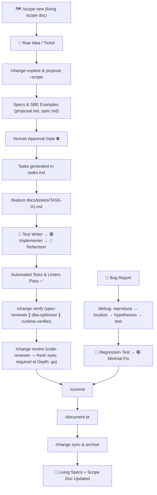

# 🚀 Workflow SSD (Spec-Driven Development) — Plugin for Claude Code

[](https://docs.anthropic.com/en/docs/agents-and-tools/claude-code)
[](https://github.com/diegomottadev/workflow-ssd-plugin)
[](LICENSE)

> **A production-ready, stack-agnostic Claude Code plugin** that brings **Spec-Driven Development (SSD)**, **strict Test-Driven Development (🔴 Red → 🟢 Green → 🔵 Refactor)**, a **7-Stage Requirements Refinement Pipeline**, and **Living Specifications** to any software project.

---

## 📖 Table of Contents

1. [What is Workflow SSD?](#-what-is-workflow-ssd)
2. [Why Use This Plugin?](#-why-use-this-plugin)
3. [What's Included?](#-whats-included)
4. [Installation Guide](#-installation-guide)
5. [Quick Start in 3 Steps](#-quick-start-in-3-steps)
6. [Command Reference & Real Execution](#-command-reference--real-execution)
   - [`/ssd-init` — Bootstrap Project](#1-ssd-init--bootstrap-project)
   - [`/scope` — Living Scope Document](#2-scope--living-scope-document)
   - [`/change` — Spec Lifecycle (OpenSpec)](#3-change--spec-lifecycle-openspec)
   - [`/refine` — Requirements to Tickets Pipeline](#4-refine--requirements-to-tickets-pipeline)
   - [`/ticket-translator` — Rapid Technical Triage](#5-ticket-translator--rapid-technical-triage)
   - [`/debug` — Root Cause Before Fix](#6-debug--root-cause-before-fix)
   - [`/feature` — Strict TDD Implementation](#7-feature--strict-tdd-implementation)
   - [`/commit` — Structured Conventional Commits](#8-commit--structured-conventional-commits)
   - [`/document` — PRs, Changelogs, Release Notes, Postmortems](#9-document--prs-changelogs-release-notes-postmortems)
   - [`/audit` — Nested Context for Monorepos](#10-audit--nested-context-for-monorepos)
   - [`/compress`, `/preserve`, `/resume` — Session Management](#11-compress-preserve-resume--session-management)
   - [`/meta-prompt` — Prompt Engineering](#12-meta-prompt--prompt-engineering)
7. [End-to-End Workflow Walkthrough](#-end-to-end-workflow-walkthrough)
8. [Specialized Subagents Catalog](#-specialized-subagents-catalog)
9. [Skills & Runbooks](#-skills--runbooks)
10. [Repository Structure](#-repository-structure)

---

## 💡 What is Workflow SSD?

Most AI coding assistants suffer from:
- **Hallucinations & phantom requirements:** Writing code without a clear specification.
- **Premature coding:** Modifying production files before understanding the architecture.
- **Untested code & broken regressions:** Altering existing logic without safety nets.
- **Orphaned tickets:** Implementing features that are never documented in living system specs.

**Workflow SSD solves this by enforcing Spec-Driven Development (SSD)**:
1. **Explore & Define First:** Write clear, verifiable specifications using Specification by Example (SBE).
2. **Slice into Atomic Tickets:** Break specifications into small, testable units of work.
3. **Strict TDD Enforcement:** Use distinct agents where the test writer *never* touches production code, and the implementer *never* touches test files.
4. **Sync Living Specs:** Merge the delta specification into domain documentation upon completion.

---

## 🎯 Why Use This Plugin?

- **Stack Agnostic:** Works seamlessly with TypeScript/Node.js, Python, Go, PHP, Java, C#, Rust, Ruby, or any custom stack.
- **Strict Role Separation:** Uses dedicated subagents with scoped tool permissions to prevent cross-contamination.
- **Non-Destructive Safety:** Enforces strict safety rules (no accidental database wipes, test transactions with rollbacks, no auto-committing without permission).
- **Two Refinement Speeds:** Fast-track BDD Example Mapping for regular features, or formal 7-stage Cockburn/UML pipeline for complex systems.

---

## 📦 What's Included?

```text
workflow-ssd-plugin/
├── commands/       # 14 Slash Commands for terminal orchestration
├── agents/         # 13 Autonomous Subagents + 7-Stage Product Pipeline
├── skills/         # 6 Domain runbooks (TDD, Debugging, Architecture, Database, Code Exploration)
└── templates/      # OpenSpec + context templates (proposal, design, tasks, delta, living specs, scope, AGENTS.md)
```

---

## 🛠️ Installation Guide

### Option 1: Install from GitHub (Recommended)

Run inside your Claude Code session:

```text
/plugin install github:diegomottadev/workflow-ssd-plugin
```

*For private repositories or SSH keys:*
```text
/plugin install git@github.com:diegomottadev/workflow-ssd-plugin.git
```

### Option 2: Local Development Mode

To test or develop the plugin locally on your machine without publishing:

```bash
claude --plugin-dir ~/Documentos/workflow-ssd-plugin
```

---

## 🚀 Quick Start in 3 Steps

### Step 1: Initialize your project
Open Claude Code inside any repository and run:
```text
/ssd-init
```
This automatically sets up `CLAUDE.md`, creates the `openspec/` directories, and prepares `docs/stories/`, `docs/tickets/`, and `docs/scope/`.

### Step 2: Configure your stack in `CLAUDE.md`
Review the generated `CLAUDE.md` and verify your testing and linting commands:
```markdown
## Test & Lint Commands
- Unit Tests: `npm test` (or `pytest`, `php vendor/bin/phpunit`, etc.)
- Linting:    `npm run lint` (or `flake8`, `golangci-lint`, etc.)
```

### Step 3: Run your first change
```text
/change propose user-email-verification
```

---

## 🎮 Command Reference & Real Execution

### 1. `/ssd-init` — Bootstrap Project

Initializes the project with all necessary directories, configurations, and templates.

```text
/ssd-init
```

**What it creates on disk:**
- `CLAUDE.md`: Main project instructions file (with auto-detected stack, test, and lint commands).
- `openspec/`: Living domain specifications, templates, active changes, and archive.
- `docs/stories/README.md`: Unified index of every story, whether it lives in a standalone file here (`/refine --deep`) or inside `openspec/changes/<name>/stories.md` (`/change propose|ff`).
- `docs/tickets/README.md`: Same idea for tickets/tasks — indexes standalone ticket files here and `openspec/changes/<name>/tasks.md` alike.

---

### 2. `/scope` — Living Scope Document

Turns a raw product idea into a **living, coarse scope document** in `docs/scope/` that persists and evolves across the whole initiative — not a one-off proposal that closes when archived.

```text
/scope new "Self-serve billing portal"
```

| Subcommand | Syntax | Description |
|---|---|---|
| **new** | `/scope new <idea>` | Creates `docs/scope/<slug>.md`: the idea, a coarse Build Order (2-6 phases), and what's explicitly out of scope. |
| **update** | `/scope update <slug>` | Advances a phase's status, links it to a `/change`, or revises the idea. Called automatically by `/change propose|ff --scope <slug>` and `/change archive`. |
| **list** | `/scope list` | Lists every scope document with its status. |

Link a phase to real work with `--scope`:
```text
/change propose billing-portal-stripe-connect --scope self-serve-billing-portal
```

---

### 3. `/change` — Spec Lifecycle (OpenSpec)

Orchestrates the lifecycle of a change proposal through specialized subagents.

| Subcommand | Syntax | Description |
|---|---|---|
| **explore** | `/change explore <idea>` | Researches the codebase *without* creating files. Answers: Does it exist? What files are affected? What are the risks? |
| **propose** | `/change propose <name> [--depth <level>] [--scope <slug>]` | Drafts `proposal.md`, `design.md`, delta specs, `stories.md`, and `tasks.md` with human approval gate. |
| **ff** | `/change ff <name> [--depth <level>] [--scope <slug>]` | **Fast-Forward:** For clear, small fixes or straightforward additions in a single pass. |
| **analyze** | `/change analyze <name>` | Audits the change package for missing edge cases, security, and testability before coding. |
| **apply** | `/change apply <name>` | Executes atomic tasks sequentially using strict TDD (`/feature`). |
| **verify** | `/change verify <name>` | Runs full test suites, linters, and verifies acceptance criteria against a **running app** (`runtime-verifier`). |
| **review** | `/change review <name>` | **Independent second pair of eyes:** `code-reviewer` audits the diff cold — no access to the implementer's own reasoning. Required at `Depth: ga`. |
| **sync** | `/change sync <name>` | Merges spec delta into living domain specs in `openspec/specs/<domain>/`; advances the linked `/scope` phase. |
| **archive** | `/change archive <name>` | Moves completed change to `openspec/archive/YYYY-MM-<name>/`; blocked until the gates its `Depth` requires are satisfied. |
| **list** | `/change list` | Lists all active and archived changes with current status. |

**Workflow Depth:** `propose`/`ff` accept `--depth prototype|alpha|beta|ga` (default `alpha`). It decides what `archive` requires: `prototype` needs only `apply`; `alpha` (today's default) adds `verify`; `beta` adds a coverage read; `ga` adds a required `review` **APPROVED** verdict plus a `/document` draft. See `commands/change.md#workflow-depth` for the full table.

**Unified index:** `propose` and `ff` register `<name>` in `docs/stories/README.md` and `docs/tickets/README.md` (status `proposed`), pointing at the change package; `archive` updates that row's status to `done` and rewrites its path to the new `openspec/archive/` location. This keeps a single browsable index regardless of whether a story/ticket came from `/change` or from `/refine --deep`.

**Example Execution:**
```text
# 1. Investigate feasibility
/change explore "Add webhook retry mechanism"

# 2. Propose the specification package (GA rigor: review + document required to archive)
/change propose webhook-retries --depth ga

# 3. Implement tasks
/change apply webhook-retries

# 4. Verify, review, and sync living specs
/change verify webhook-retries
/change review webhook-retries
/change sync webhook-retries
/change archive webhook-retries
```

---

### 4. `/refine` — Requirements to Tickets Pipeline

Turns raw business requests or specifications into structured tickets and OpenSpec changes. Offers two speeds:

#### A. Standard Mode (Fast-Track BDD)
Ideal for standard features, business rule tweaks, and common tickets. Dispatches the `functional-analyst` to run an **Example Mapping (Three Amigos)** session in 1 step:
- Extracts the INVEST user story.
- Distills invariant business rules.
- Builds concrete **Specification by Example (SBE)** tables.
- Directly creates the OpenSpec change package.

```text
/refine "Allow customers to apply a 15% promotional discount if cart subtotal exceeds $100 and payment is debit"
```

#### B. Deep Mode (7 Formal Stages)
Activated with `--deep` or for complex workflows, new sub-systems, or large `.docx` specifications. Stops at **sequential approval gates**:

```text
/refine docs/specs/checkout-overhaul.md --deep --id REQ-2026-09-checkout
```

**The 7 Stages:**
1. `00-requirement-enumerator`: Builds atomic requirement inventory (`docs/diagrams/use-cases/<ID>-requirement-inventory.md`).
2. `01-use-case-generator`: Writes Cockburn-style user-goal use cases (`docs/diagrams/use-cases/<ID>-use-cases.md`).
3. `02-cockburn-validator`: Audits use cases against Cockburn and Larman rules (Loops until approved).
4. `03-diagram-generator`: Generates UML sequence diagrams mapping code components (`docs/diagrams/sequence/<ID>/`).
5. `04-diagram-validator`: Audits diagrams for consistency and parsing validity.
6. `05-invest-stories`: Slices use cases into INVEST user stories with Given-When-Then scenarios (`docs/stories/`).
7. `06-ticket-generator`: Produces technical tickets in `docs/tickets/` and opens OpenSpec change packages.

---

### 5. `/ticket-translator` — Rapid Technical Triage

Performs rapid diagnosis on incoming bug reports or feature tickets without starting a full refinement cycle.

```text
/ticket-translator "Error 500 when exporting CSV with more than 10k rows"
```
*Or passing an issue identifier:*
```text
/ticket-translator ISSUE-4921
```

**Output:**
- Identifies exact source files and line ranges involved.
- Classifies issue type (Bug, Missing Feature, Performance, Schema).
- Generates reproduction steps and acceptance criteria.
- Recommends whether to use `/change ff` or `/change propose`.

---

### 6. `/debug` — Root Cause Before Fix

Investigates a bug through evidence before writing any fix — distinct from `/ticket-translator`, which triages and specs a ticket without root-causing it.

```text
/debug "Error 500 when exporting CSV with more than 10k rows"
```

**The Loop:**
```text
🔍 REPRODUCE ─► 🔬 LOCALIZE ─► 💡 HYPOTHESIZE ─► 🧪 TEST ─► ⛔ GATE ─► 🔴 RED ─► 🟢 GREEN ─► ✅ VERIFY
```

- `bug-investigator` runs the read-only investigation and reports root cause + evidence + blast radius.
- The user reviews the report at the gate before any code changes.
- `tdd-test-writer` writes the regression test (🔴), `tdd-implementer` writes the minimal fix (🟢).

---

### 7. `/feature` — Strict TDD Implementation

Implements a single technical ticket from `docs/tickets/` following the strict TDD cycle:

```text
/feature docs/tickets/TK-01-jwt-authentication.md
```

**The Strict 4-Step Cycle:**
```text
[Ticket Input]
      │
      ▼
┌───────────────────────┐
│ 🔴 tdd-test-writer    │ ◄── Writes failing tests. Never touches production code.
└───────────┬───────────┘
            │
            ▼
┌───────────────────────┐
│ 🟢 tdd-implementer    │ ◄── Writes minimal code to reach green. Never edits tests.
└───────────┬───────────┘
            │
            ▼
┌───────────────────────┐
│ 🔵 tdd-refactorer     │ ◄── Cleans up code while keeping test suite green.
└───────────┬───────────┘
            │
            ▼
┌───────────────────────┐
│ 🟣 Mutation / Audit   │ ◄── Validates test quality (Infection/Stryker) + DBA review.
└───────────────────────┘
```

**Lifecycle of a ticket file:**
`docs/tickets/TK-01.md` → `docs/tickets/process/TK-01.md` → `docs/tickets/done/TK-01.md`.

---

### 8. `/commit` — Structured Conventional Commits

Inspects your working tree diff and active tickets to draft a standard Conventional Commit message.

```text
/commit
```
*With an explicit ticket reference:*
```text
/commit --ticket TK-1042
```

**Safety Note:** This command **never executes `git commit` automatically**. It displays the prepared message, branch check, and command for you to review and confirm.

---

### 9. `/document` — PRs, Changelogs, Release Notes, Postmortems

Drafts human-facing documentation grounded strictly in real `git log`/`git diff` output — never invented content.

```text
/document pr
/document changelog
/document release-note v1.2.0
/document postmortem "checkout outage 2026-09-15"
```

**Safety Note:** Drafts are shown in chat first. `gh pr create`/`gh pr edit` and any other outward-facing action only run after explicit confirmation.

---

### 10. `/audit` — Nested Context for Monorepos

Generates or gap-fills nested `AGENTS.md` files for distinct areas (`apps/`, `packages/`, `services/`) — complementing the root `CLAUDE.md`, not replacing it.

```text
/audit
/audit apps/api
```

Skips entirely on a single cohesive app — `CLAUDE.md` alone is enough there. Never overwrites curated content without asking.

---

### 11. `/compress`, `/preserve`, `/resume` — Session Management

Manage long conversations and context windows cleanly:

- **`/compress`**: Summarizes the conversation, records pending tasks in `docs/session-logs/YYYY-MM-DD-<slug>.md`, and frees context.
- **`/preserve`**: Saves architectural learnings and conventions directly to `CLAUDE.md`.
- **`/resume`**: Restores active context from previous session logs.

```text
/compress
/resume docs/session-logs/2026-09-14-checkout-tdd.md
```

---

### 12. `/meta-prompt` — Prompt Engineering

Refines ambiguous prompts using role, context, constraints, and observable verification outcomes:

```text
/meta-prompt "refactor repository layer to support caching"
```

---

## 🔄 End-to-End Workflow Walkthrough

Here is how a real feature goes from an idea to production:



---

## 🤖 Specialized Subagents Catalog

| Agent | Responsibility | Tool Restrictions |
|---|---|---|
| `product-owner` | Clarifies business value, user personas, and scope boundaries. | Read-only |
| `functional-analyst` | Distills business rules, SBE tables, and edge cases. | Read-only |
| `spec-reviewer` | Audits specifications against SBE quality standards. | Read-only |
| `tdd-test-writer` | **RED:** Writes failing unit and integration tests. | Read, Write tests, Bash (tests) |
| `tdd-implementer` | **GREEN:** Writes minimum production code to pass tests. Stops and escalates to `/change propose` if a library/provider/data-model choice has no named source in `design.md` or the codebase. | Read, Write source, Bash (tests) |
| `tdd-refactorer` | **REFACTOR:** Improves code structure while keeping tests green. | Read, Write source, Bash (tests) |
| `fullstack-developer` | Implements small bugfixes and fast-forward changes (`ff`). Same decision-owed gate as the TDD Implementer — never invents an unmade library/provider/data-model choice. | Read, Write, Bash |
| `dba-optimizer` | Audits SQL queries, indexing, and migration safety. | Read-only |
| `bug-investigator` | Reproduces, localizes, and proves a bug's root cause before any fix (`/debug`). | Read, Grep, Glob, Bash |
| `runtime-verifier` | Proves delta-spec SBE examples by running the real app/CLI/API (`/change verify`). | Read, Grep, Glob, Bash |
| `code-reviewer` | Independent, fresh-eyes review of the diff for correctness, security, and consistency — no access to the implementer's reasoning (`/change review`). | Read, Grep, Glob, Bash |
| `doc-writer` | Drafts PR descriptions, changelogs, release notes, and postmortems from real git history (`/document`). | Read, Grep, Glob, Bash |
| `commit-message-writer` | Formats conventional commit messages linked to tickets. | Read-only |
| `product-agent/` (00–06) | 7-stage formal pipeline (Requirements → Use Cases → Diagrams → Stories → Tickets). | Scoped per stage |

---

## 🧠 Skills & Runbooks

- **`tdd-workflow`**: Step-by-step TDD protocol, characterization testing for legacy code, and mutation testing.
- **`debug-workflow`**: Root-cause investigation loop (reproduce → localize → hypothesize → test) that hands off to the TDD cycle for the fix.
- **`architecture-first`**: Enforces pattern-matching against existing project idioms before creating new abstractions.
- **`coding-patterns`**: Separation of Concerns (Controller → Service/Action → Model/Repository) and defensive coding.
- **`explore-codebase`**: High-efficiency search recipes avoiding token waste.
- **`data-model`**: Rules for safe schema evolution, non-destructive migrations, and query optimization.

---

## 📂 Repository Structure

```text
workflow-ssd-plugin/
├── .claude-plugin/
│   └── plugin.json                    # Plugin manifest
├── README.md                          # Main documentation & user guide
├── commands/                          # Slash commands catalog
│   ├── audit.md
│   ├── change.md
│   ├── commit.md
│   ├── compress.md
│   ├── debug.md
│   ├── document.md
│   ├── feature.md
│   ├── meta-prompt.md
│   ├── preserve.md
│   ├── refine.md
│   ├── resume.md
│   ├── scope.md
│   ├── ssd-init.md
│   └── ticket-translator.md
├── agents/                            # Specialized subagent definitions
│   ├── bug-investigator.md
│   ├── code-reviewer.md
│   ├── commit-message-writer.md
│   ├── dba-optimizer.md
│   ├── doc-writer.md
│   ├── fullstack-developer.md
│   ├── functional-analyst.md
│   ├── product-owner.md
│   ├── runtime-verifier.md
│   ├── spec-reviewer.md
│   ├── tdd-implementer.md
│   ├── tdd-refactorer.md
│   ├── tdd-test-writer.md
│   └── product-agent/                 # 7-Stage pipeline agents
│       ├── 00-requirement-enumerator.md
│       ├── 01-use-case-generator.md
│       ├── 02-cockburn-validator.md
│       ├── 03-diagram-generator.md
│       ├── 04-diagram-validator.md
│       ├── 05-invest-stories.md
│       └── 06-ticket-generator.md
├── skills/                            # Agent skills and guidelines
│   ├── architecture-first/
│   ├── coding-patterns/
│   ├── data-model/
│   ├── debug-workflow/
│   ├── explore-codebase/
│   └── tdd-workflow/
└── templates/                         # OpenSpec + context templates for projects
    ├── AGENTS.md.template
    ├── CLAUDE.md.template
    ├── docs/
    │   ├── scope-index.md.template
    │   ├── scope.md.template
    │   ├── stories-index.md.template
    │   └── tickets-index.md.template
    └── openspec/
        ├── circuit.md
        ├── design.md
        ├── project.md.template
        ├── proposal.md
        ├── spec-delta.md
        ├── spec-living.md
        ├── stories.md
        └── tasks.md
```

---

## 📄 License

MIT © [Diego Motta](https://github.com/diegomottadev)
